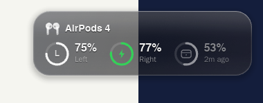

# BazzitePods

AirPods on Linux, the way they work on an iPhone. You install it once, and from then on it
just works: it starts with your session, finds your AirPods, shows accurate battery levels
for each pod and the case, and shows a small glass overlay over your games.

Built for [Bazzite](https://bazzite.gg) (KDE Plasma, Wayland), and it works on any Flatpak
desktop. BazzitePods is a modified fork of [LibrePods](https://github.com/librepods-org/librepods)
(see [Credits and licence](#credits-and-licence)).

<p align="center">
  
</p>

## Install

Run this in a terminal (Konsole). It needs no sudo, and nothing is layered into the system
image:

```bash
curl -fsSL https://raw.githubusercontent.com/DaBarkle/bazzitepods/bazzite/linux-rust/packaging/install-bazzite.sh | bash
```

That's all. BazzitePods appears in your system tray and starts by itself at every login.
Connect your AirPods in **System Settings → Bluetooth** as usual and the battery levels show
up within a few seconds.

- To install a bundle you already downloaded, run `... | bash -s -- ~/Downloads/BazzitePods.flatpak`.
- To uninstall, run `... | bash -s -- --uninstall`.

## Features

- **Accurate battery for left, right and case**, including charging state. A pod that drops
  out keeps its last value, dimmed, instead of showing 0%. The case shows its last known level
  after the pods come out. Like on an iPhone, the case reports its level while at least one pod
  is inside it.
- **Game overlay** with four modes:
  - **Compact** (default): a small widget that expands to the full card when something
    changes, such as a pod going in or out, charging, or low battery.
  - **Pop-up**: appears briefly on changes, then goes away.
  - **Full**: always shows the full card while connected.
  - **Off**.
- **Liquid glass.** A **Glass** slider goes from smoked to clear glass. A **Game opacity**
  slider makes the overlay see-through only while a fullscreen game or video is in front, and
  it stays solid on the desktop. Text and icons have a built-in contrast halo, so they stay
  readable on bright and dark scenes alike.
- **Keeps audio working.** It fixes the classic "walked away, came back, connected but
  silent" problem. It never leaves the audio card switched off, renegotiates A2DP when needed,
  restores your default output, and reconnects the AirPods by itself when they come back in
  range.
- **Controls.** Noise control (when your model has it), ear detection with media pause and
  resume, conversational awareness and renaming. Only the controls your model supports are
  shown.
- **Hands-off.** Survives Bluetooth restarts, adapter hot-plug and suspend/resume. It never
  turns Bluetooth on by itself. Launching it a second time just opens the window.

| Full overlay | Compact widget |
| --- | --- |
|  |  |

## Safe with anti-cheat

The overlay is an ordinary desktop surface drawn by its own process on the compositor's
overlay layer (wlr-layer-shell). It doesn't touch games:

- no Vulkan or OpenGL layers, no `LD_PRELOAD`, no injection or hooking
- no ptrace, no reading other processes' memory or `/proc`
- no screen capture: the overlay never reads what's behind it
- click-through, and it never takes keyboard focus

Fullscreen detection asks KWin (through a small KWin script) whether the active window is
fullscreen. It's a question to the window manager, not a look at the game.

## Supported setups

| Desktop | Overlay | Battery, controls, tray |
| --- | --- | --- |
| KDE Plasma 6 (Bazzite default) | Full, with smart fullscreen transparency | Yes |
| Other wlr-layer-shell compositors (Hyprland, Sway, …) | Yes (solid; no fullscreen detection) | Yes |
| GNOME | Desktop notifications instead | Yes |
| Steam Gaming Mode (gamescope) | Not available | Yes |

**AirPods:** AirPods 4 (with and without noise cancellation), AirPods Pro 2 and 3, AirPods 3,
AirPods Max and others. Battery and ear detection work on all of them. Feature controls follow
each model's abilities.

## Testing and development

- Hardware test steps: [`linux-rust/docs/TESTING.md`](linux-rust/docs/TESTING.md)
- Design and rules: [`linux-rust/docs/ARCHITECTURE.md`](linux-rust/docs/ARCHITECTURE.md)
- Build: `cd linux-rust && cargo build --release`, or `just flatpak` for the Flatpak.

This repository still contains upstream LibrePods' Android app (`android/`) and its older Qt
Linux app (`linux/`). BazzitePods is the Rust app in `linux-rust/`.

## Credits and licence

BazzitePods is a modified version of **LibrePods** by Kavish Devar and the LibrePods
contributors (<https://github.com/librepods-org/librepods>). The AirPods protocol work,
the Bluetooth core and much of the device logic come from LibrePods. This fork adds the
Bazzite packaging, the overlay, the audio-recovery and battery logic, and the new interface.

BazzitePods - AirPods on Bazzite and other Linux desktops
Copyright (C) 2025 LibrePods contributors
Copyright (C) 2026 BazzitePods contributors

This program is free software: you can redistribute it and/or modify it under the terms of
the GNU Affero General Public License as published by the Free Software Foundation, version 3
of the License. It is distributed in the hope that it will be useful, but WITHOUT ANY
WARRANTY; without even the implied warranty of MERCHANTABILITY or FITNESS FOR A PARTICULAR
PURPOSE. See the [GNU Affero General Public License](LICENSE) for more details.

BazzitePods is not affiliated with, endorsed by or sponsored by Apple Inc. AirPods, iPhone
and other Apple marks are trademarks of Apple Inc. All other trademarks belong to their
respective owners. The interface uses the Inter typeface (SIL Open Font License).
