# BazzitePods

AirPods on Linux, the way they work on an iPhone. You install it once, and from then on it
just works: it starts with your session, finds your AirPods, shows accurate battery levels
for each pod and the case, and shows a small glass overlay over your games.

Built for [Bazzite](https://bazzite.gg) (KDE Plasma, Wayland), and it works on any Flatpak
desktop.

> **A fork of [LibrePods](https://github.com/librepods-org/librepods).** LibrePods did the
> hard part: reverse-engineering Apple's AirPods protocol. BazzitePods builds a
> zero-config desktop app on top of it. See [How it builds on LibrePods](#how-it-builds-on-librepods).

<p align="center">
  
</p>
<p align="center">
  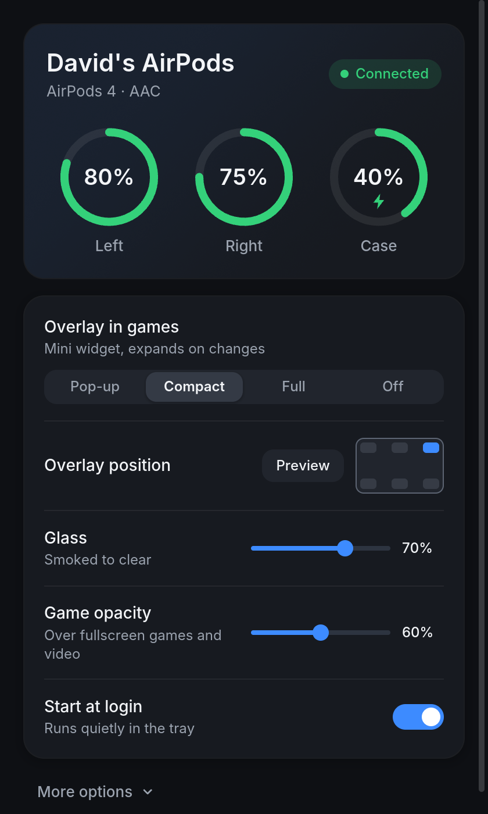
  &nbsp;
  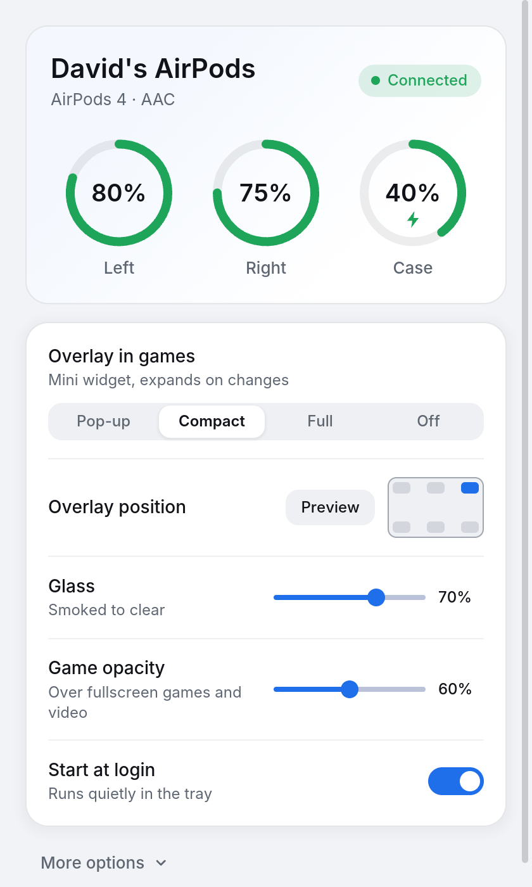
</p>

## Install

Run this in a terminal (Konsole). It needs no sudo, and nothing is layered into the system
image:

```bash
curl -fsSL https://raw.githubusercontent.com/DaBarkle/bazzitepods/main/linux-rust/packaging/install-bazzite.sh | bash
```

That's all. BazzitePods appears in your system tray and starts by itself at every login.
Connect your AirPods in **System Settings → Bluetooth** as usual and the battery levels show
up within a few seconds.

- To install a bundle you already downloaded, run `... | bash -s -- ~/Downloads/BazzitePods.flatpak`.
- To uninstall, run `... | bash -s -- --uninstall`.

## Features

- **Accurate battery for left, right and case**, including charging state. A pod that drops
  out keeps its last value, dimmed, instead of showing 0%. The case shows its last known level
  after the pods come out. Like on an iPhone, the case reports its level while at least one pod
  is inside it.
- **Game overlay** with four modes:
  - **Compact** (default): a small widget that expands to the full card when something
    changes, such as a pod going in or out, charging, or low battery.
  - **Pop-up**: appears briefly on changes, then goes away.
  - **Full**: always shows the full card while connected.
  - **Off**.
- **Liquid glass.** A **Glass** slider goes from smoked to clear glass. A **Game opacity**
  slider makes the overlay see-through only while a fullscreen game or video is in front, and
  it stays solid on the desktop. Text and icons have a built-in contrast halo, so they stay
  readable on bright and dark scenes alike.
- **Keeps audio working.** It fixes the classic "walked away, came back, connected but
  silent" problem. It never leaves the audio card switched off, renegotiates A2DP when needed,
  restores your default output, and reconnects the AirPods by itself when they come back in
  range.
- **Controls.** Noise control (when your model has it), ear detection with media pause and
  resume, conversational awareness and renaming. Only the controls your model supports are
  shown.
- **Multiple devices.** When your iPhone or Mac takes the AirPods, BazzitePods pauses
  what's playing here and shows **On another device**, while the AirPods stay connected.
  Press **Use on this PC** (or just start playing something) to bring the audio back. The
  overlay pops up when the audio moves.
- **Hands-off.** Survives Bluetooth restarts, adapter hot-plug and suspend/resume. It never
  turns Bluetooth on by itself. Launching it a second time just opens the window.

## A tour

### At a glance

The window shows every state at a glance, so you always know what your AirPods are doing.

| Connected | On another device | Out of range | Low battery |
| --- | --- | --- | --- |
| 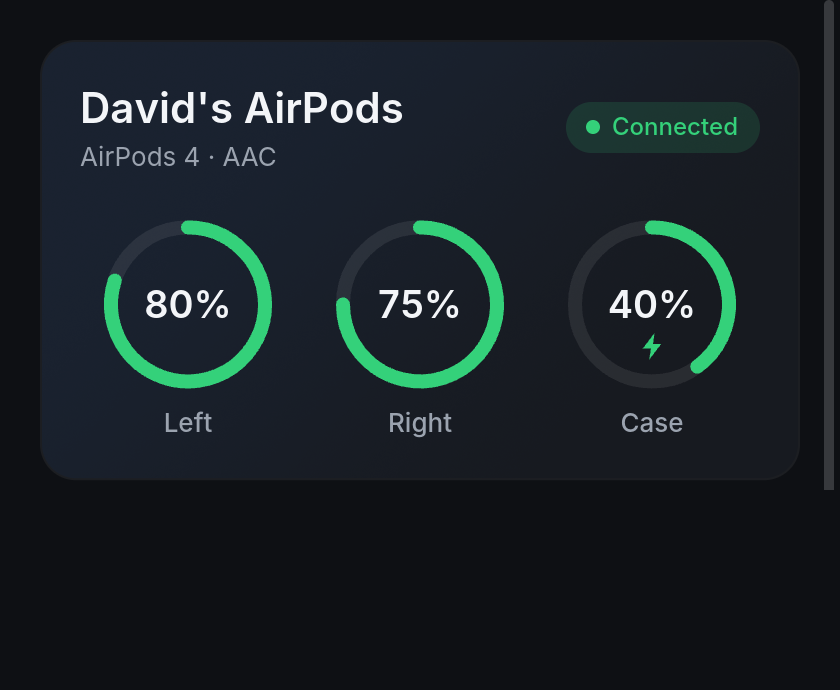 | 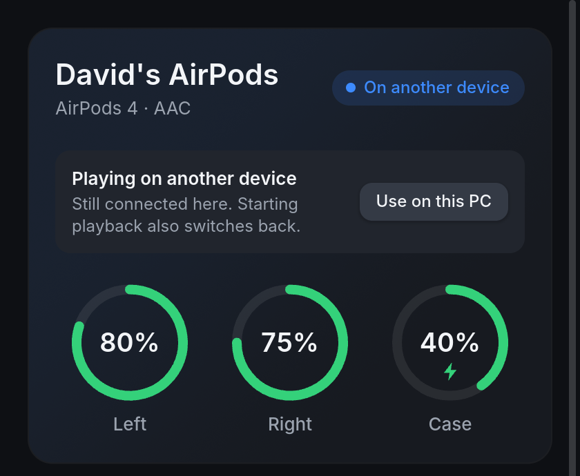 | 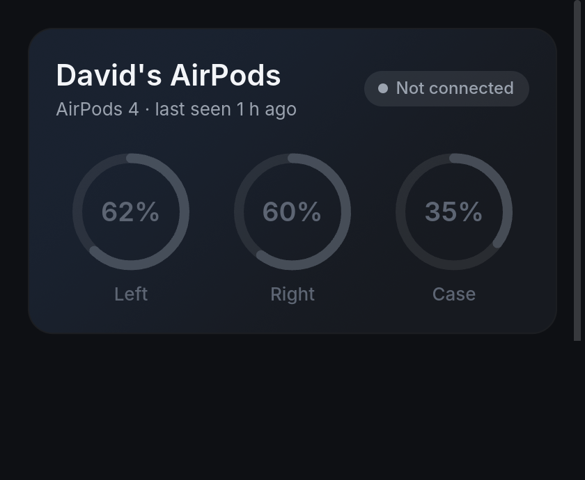 | 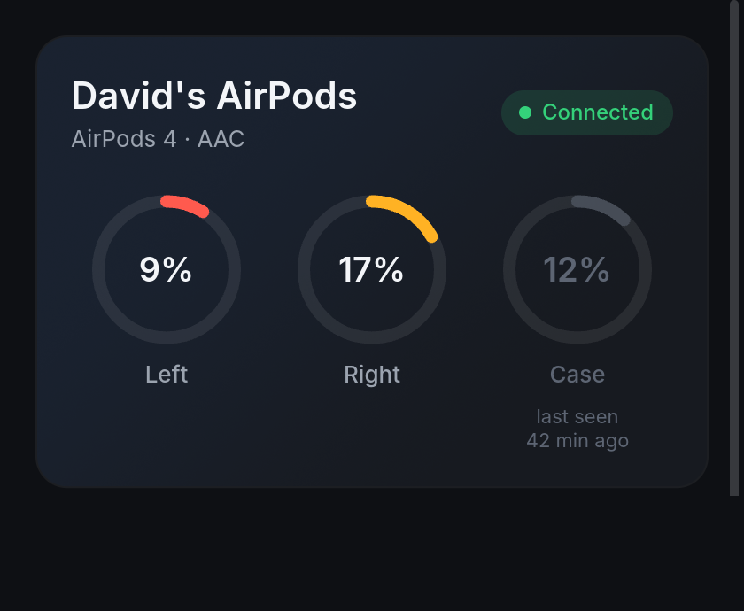 |

### Controls and settings

Models with noise control get Transparency, Adaptive and Noise Cancellation tiles, plus
conversation awareness. **More options** has the theme, Apple device mode and stem-press
track control.

<p align="center">
  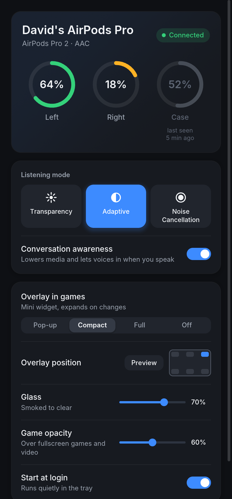
  &nbsp;
  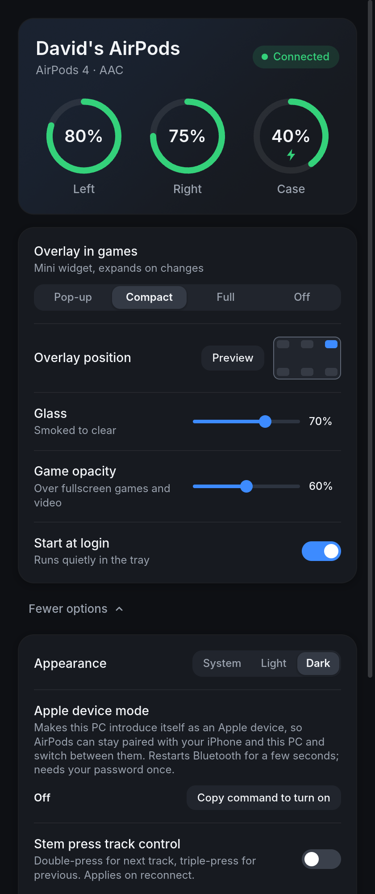
</p>

### The overlay

| Full card | Compact widget |
| --- | --- |
| 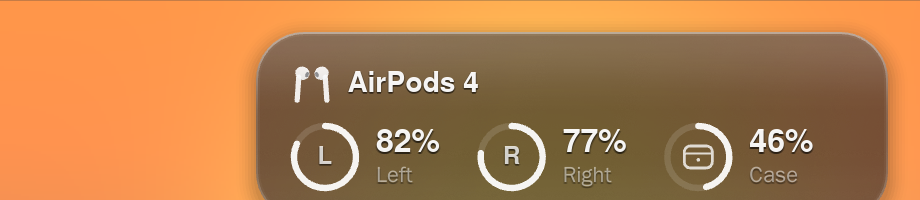 |  |
| 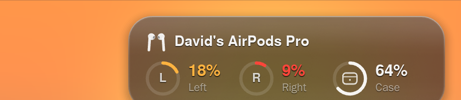 | 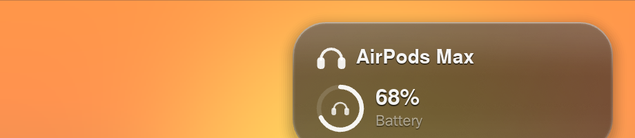 |

### Tray

The tray icon is a battery ring around your AirPods. It turns amber and then red as the
battery runs low, shows a bolt while charging, and greys out when disconnected.

<p align="center">
  
</p>

## How it works

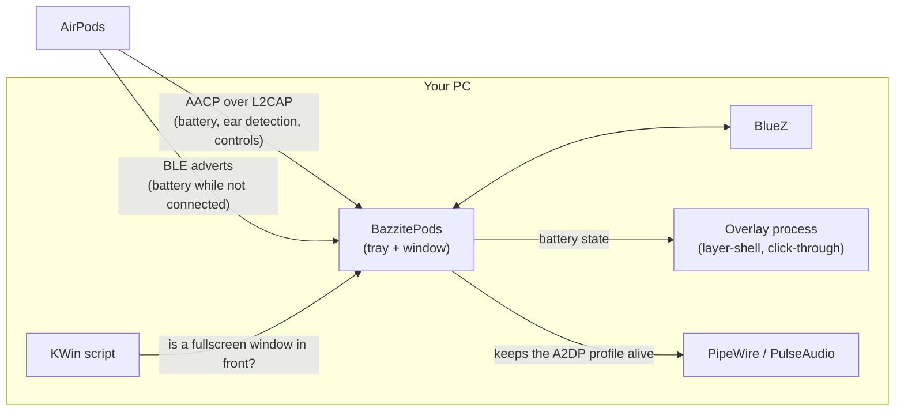

1. **Talking to the AirPods.** BazzitePods opens Apple's private control channel (AACP) on
   the AirPods through BlueZ, the same way an iPhone does. That gives exact battery levels
   for each pod and the case, ear detection, noise control and device switching. While the
   AirPods are away, it reads their encrypted Bluetooth LE adverts instead, so you still see
   levels when you open the case.
2. **One source of truth.** Everything the AirPods report goes into a single state hub. The
   window, tray and overlay all draw from it, so they never disagree.
3. **The overlay** is a separate, tiny process on the compositor's overlay layer. It never
   touches a game; see [Safe with anti-cheat](#safe-with-anti-cheat). It only sets up the GPU
   while it's visible: hidden, it uses about 10 MB of memory and no CPU.
4. **Fullscreen detection.** A small KWin script tells BazzitePods when the active window is
   fullscreen, and the overlay turns translucent.
5. **Audio guard.** It watches the Bluetooth audio profile and the default output. If the
   AirPods come back "connected but silent", it renegotiates A2DP and restores your output.

## How it builds on LibrePods

[LibrePods](https://github.com/librepods-org/librepods) reverse-engineered the AirPods
protocol and wrote a Linux app in Rust. BazzitePods keeps that core and builds a new app
around it.

| From LibrePods | Added in BazzitePods |
| --- | --- |
| The AACP protocol implementation: handshake, battery, ear detection, listening modes, conversation awareness, rename, device-switching packets | Zero-config Flatpak packaging, a one-line installer, autostart and tray |
| Decrypting AirPods Bluetooth LE adverts with the proximity keys | Battery logic: one value per pod and case, last seen, cached case level |
| Media pause and resume on ear detection | The game overlay (compact, pop-up, full), liquid glass, fullscreen detection |
| The Rust Bluetooth groundwork with BlueZ (`bluer`) | The audio guard that fixes the "connected but silent" bug, plus reconnect with backoff |
| The first Rust desktop app for Linux (iced window and tray) | A new interface (window, tray, icons), multi-device switching UI, Apple device mode |

Upstream's original branches are kept in this repo: `upstream-main` (the Android and Qt
apps) and `linux/rust`.

## Apple device mode (optional)

AirPods behave best with devices that introduce themselves as Apple devices: they switch
between them automatically and stay paired with both your iPhone and your PC. Apple device
mode makes your PC's Bluetooth report Apple's vendor ID (`004C`) to the AirPods. It's off by
default and changes one line in a system file, so BazzitePods never does it on its own.

To turn it on, open **Settings → More options → Apple device mode** and press the button to
copy the command, or run it yourself. It makes a backup, adds the line, and restarts
Bluetooth (your devices drop for a few seconds):

```bash
sudo cp -a /etc/bluetooth/main.conf /etc/bluetooth/main.conf.bak-bazzitepods && sudo sed -i '/^\[General\]/a DeviceID = bluetooth:004C:0000:0000' /etc/bluetooth/main.conf && sudo systemctl restart bluetooth
```

To undo it:

```bash
sudo sed -i '/^DeviceID = bluetooth:004C:/d' /etc/bluetooth/main.conf && sudo systemctl restart bluetooth
```

Your other Bluetooth devices are not affected. Changes in `/etc` are kept across Bazzite
updates.

## Safe with anti-cheat

The overlay is an ordinary desktop surface drawn by its own process on the compositor's
overlay layer (wlr-layer-shell). It doesn't touch games:

- no Vulkan or OpenGL layers, no `LD_PRELOAD`, no injection or hooking
- no ptrace, no reading other processes' memory or `/proc`
- no screen capture: the overlay never reads what's behind it
- click-through, and it never takes keyboard focus

Fullscreen detection asks KWin (through a small KWin script) whether the active window is
fullscreen. It's a question to the window manager, not a look at the game.

## Supported setups

| Desktop | Overlay | Battery, controls, tray |
| --- | --- | --- |
| KDE Plasma 6 (Bazzite default) | Full, with smart fullscreen transparency | Yes |
| Other wlr-layer-shell compositors (Hyprland, Sway, …) | Yes (solid; no fullscreen detection) | Yes |
| GNOME | Desktop notifications instead | Yes |
| Steam Gaming Mode (gamescope) | Not available | Yes |

**AirPods:** AirPods 4 (with and without noise cancellation), AirPods Pro 2 and 3, AirPods 3,
AirPods Max and others. Battery and ear detection work on all of them. Feature controls follow
each model's abilities.

## Testing and development

- Hardware test steps: [`linux-rust/docs/TESTING.md`](linux-rust/docs/TESTING.md)
- Design and rules: [`linux-rust/docs/ARCHITECTURE.md`](linux-rust/docs/ARCHITECTURE.md)
- Build: `cd linux-rust && cargo build --release`, or `just flatpak` for the Flatpak.

BazzitePods is the Rust app in `linux-rust/`. The `android/` and `linux/` folders are
upstream LibrePods' Android app and older Qt Linux app, kept as they were.

## Credits and licence

BazzitePods is a modified version of **LibrePods** by Kavish Devar and the LibrePods
contributors (<https://github.com/librepods-org/librepods>). The AirPods protocol work,
the Bluetooth core and much of the device logic come from LibrePods. This fork adds the
Bazzite packaging, the overlay, the audio-recovery and battery logic, and the new interface.

BazzitePods - AirPods on Bazzite and other Linux desktops
Copyright (C) 2025 LibrePods contributors
Copyright (C) 2026 BazzitePods contributors

This program is free software: you can redistribute it and/or modify it under the terms of
the GNU Affero General Public License as published by the Free Software Foundation, version 3
of the License. It is distributed in the hope that it will be useful, but WITHOUT ANY
WARRANTY; without even the implied warranty of MERCHANTABILITY or FITNESS FOR A PARTICULAR
PURPOSE. See the [GNU Affero General Public License](LICENSE) for more details.

BazzitePods is not affiliated with, endorsed by or sponsored by Apple Inc. AirPods, iPhone
and other Apple marks are trademarks of Apple Inc. All other trademarks belong to their
respective owners. The interface uses the Inter typeface (SIL Open Font License).
